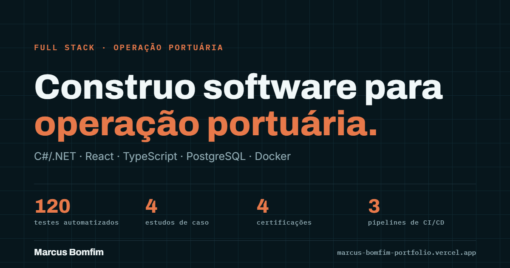

# Portfólio — Marcus Bomfim

Portfólio profissional de Marcus Bomfim, desenvolvedor Full Stack. O site é construído em torno de um recorte específico: **software para operação portuária e logística**, o domínio em que estão todos os projetos apresentados.

**Acesse o projeto:** [marcus-bomfim-portfolio.vercel.app](https://marcus-bomfim-portfolio.vercel.app/)



## Conteúdo

- Apresentação com posicionamento no setor portuário e prova numérica logo abaixo
- Quatro estudos de caso com problema, desafio, decisões técnicas e resultado
- Métricas verificáveis nos projetos: testes automatizados, pipelines de CI, perfis de acesso
- Competências de front-end, back-end, dados e entrega
- Certificados de C# com Microsoft, AWS e Cisco, com documentos e validações disponíveis
- Captura real do AsiaLogService conectado à API e ao SQL Server
- Trajetória profissional, incluindo a vivência anterior em corretagem de navios
- Links para LinkedIn, GitHub, currículo em PDF e contato por e-mail

## Tecnologias

- React 19
- TypeScript
- Vite
- CSS puro, organizado por seção
- Lucide React e React Icons

## Idiomas e temas

O site funciona em **português e inglês**, com alternância no cabeçalho. O idioma inicial segue a preferência do navegador e fica salvo entre visitas, junto com o atributo `lang` do documento.

Os temas claro e escuro seguem a preferência do sistema, também com alternância manual e persistência. Um script inline resolve tema e idioma antes da hidratação, para não haver piscada na carga.

## Identidade visual

A paleta e a tipografia saem do vocabulário do porto:

| Token | Cor | Uso |
| --- | --- | --- |
| Casco | `#07161c` | Fundo do tema escuro |
| Névoa | `#eef1f2` | Fundo do tema claro |
| Boia | `#a9421f` | Ação — reservada ao que é clicável |
| Sondagem | `#0c5c52` | Confirmação e apoio |
| Bruma | `#536c76` | Texto auxiliar |

A tipografia usa três papéis: **Archivo** nos títulos, **Inter** no texto corrido e **IBM Plex Mono** em rótulos, métricas e dados.

## Qualidade e acessibilidade

Navegação responsiva, suporte a teclado, link para pular ao conteúdo, foco visível, respeito à preferência por movimento reduzido, alvos de toque de no mínimo 2,5rem e contraste conferido nos dois temas.

Também há metadados para mecanismos de busca e compartilhamento em redes sociais, dados estruturados de `Person` e uma imagem própria de prévia de links.

## Estrutura

```text
src/
├── components/
│   ├── layout/        Header e Footer
│   └── ui/            ProjectCard, SectionHeading, alternadores
├── data/              Conteúdo em português e inglês
├── i18n/              Contexto de idioma e hooks
├── sections/          Uma seção por arquivo
├── styles/
│   ├── layout/        Contêiner, cabeçalho e rodapé
│   ├── sections/      Um arquivo de estilo por seção
│   ├── variables.css  Tokens de cor, tipografia e espaçamento
│   └── index.css      Ordem da cascata
└── types/             Contratos de conteúdo
```

Os textos ficam em `src/data/portfolio.ts`. Dados que não mudam com o idioma — endereços, tecnologias, números e caminhos de arquivo — ficam declarados uma única vez no topo do arquivo, e o TypeScript garante que as duas traduções tenham exatamente os mesmos campos.

## Como executar

É necessário ter o Node.js instalado.

```powershell
git clone https://github.com/MarcusBomfim/Portfolio.git
cd Portfolio
npm.cmd install
npm.cmd run dev
```

Abra o endereço informado pelo Vite no terminal.

## Comandos disponíveis

```powershell
# Ambiente de desenvolvimento
npm.cmd run dev

# Verificação de código
npm.cmd run lint

# Compilação para produção
npm.cmd run build

# Prévia da versão compilada
npm.cmd run preview

# Lint e build em sequência
npm.cmd run check
```

Os arquivos de produção são gerados na pasta `dist`.

## Atualizar o currículo

Substitua `public/curriculo-marcus-bomfim.pdf`. O nome do arquivo baixado e a data exibida na dica do botão ficam em `curriculum`, no topo de `src/data/portfolio.ts`.

## Adicionar a demonstração de um projeto

Os cards exibem um botão **Ver demonstração** em destaque assim que existe um endereço publicado. Preencha o objeto `demos` em `src/data/portfolio.ts`:

```ts
const demos: Partial<Record<keyof typeof repositories, string>> = {
  ships: 'https://escalas.exemplo.com.br',
}
```

Sem endereço, o card mostra apenas o link do repositório.

## Publicação na Vercel

A forma recomendada de publicar este projeto é conectar o repositório do GitHub à Vercel. Assim, cada atualização enviada para a branch `main` gera automaticamente uma nova versão de produção.

1. Envie as alterações para o GitHub.
2. Acesse [vercel.com](https://vercel.com/) e entre com sua conta do GitHub.
3. Selecione **Add New > Project**.
4. Importe o repositório `MarcusBomfim/Portfolio`.
5. Confirme as configurações detectadas:
   - Framework Preset: `Vite`
   - Root Directory: `./`
   - Build Command: `npm run build`
   - Output Directory: `dist`
6. Selecione **Deploy**.

Este portfólio não utiliza variáveis de ambiente. A versão de produção está disponível em [marcus-bomfim-portfolio.vercel.app](https://marcus-bomfim-portfolio.vercel.app/).

Branches diferentes da `main` podem ser utilizadas para gerar versões de prévia antes de publicar mudanças em produção.

## Autor

**Marcus Bomfim** — Desenvolvedor Full Stack

- [GitHub](https://github.com/MarcusBomfim)
- [LinkedIn](https://www.linkedin.com/in/marcus-bomfim-625495367/)
- [E-mail](mailto:marcusbomfimm@gmail.com)
